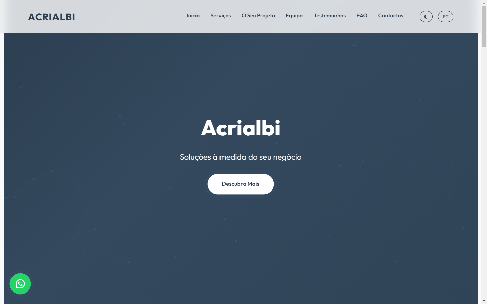

# 🎨 ACRIALBI — Institutional & Creative Web Multimedia Showcase

> **Live Website:** [https://acrialbi.netlify.app](https://acrialbi.netlify.app)  
> **Author:** Fábio Júnior Fernandes Silva — BSc in Web Multimedia Development @ IPCA (Portugal)

---

## 🌟 Overview & How It Works

**ACRIALBI** is a live web platform presenting institutional initiatives, community events, and multimedia showcases. Engineered with clean semantic markup, responsive grid architecture, and accessible navigation patterns.

### Key Highlights
- **Structured Information Architecture**: Clear presentation of institutional programs, news, and visual galleries.
- **Responsive Design System**: Adapts seamlessly across desktop, tablet, and smartphone screens.
- **Fast Static Delivery**: Optimized assets and zero-dependency frontend deployed on Netlify's CDN.

---

## 🛠️ Tech Stack

- **Frontend**: Semantic HTML5, CSS3 Grid & Flexbox, JavaScript
- **Design**: User-Centered UI/UX, Accessible Color Contrast
- **Deployment**: Netlify (`acrialbi.netlify.app`)
